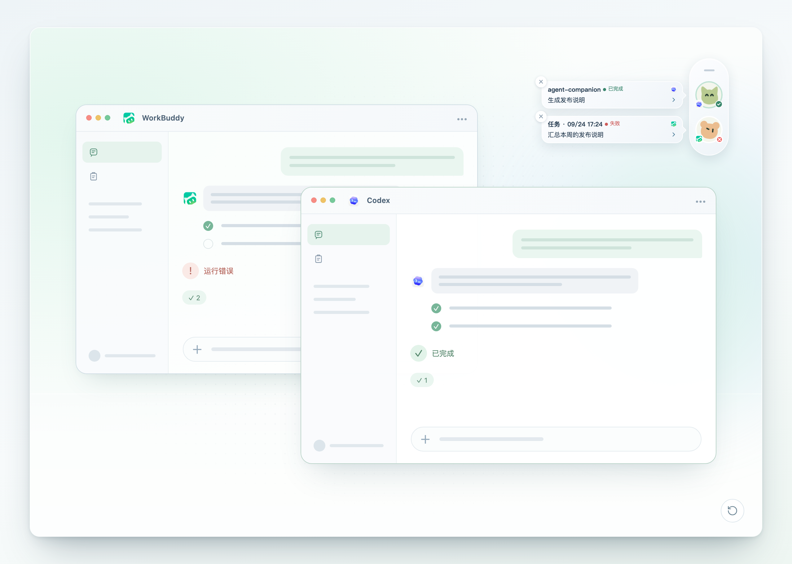

# workbuddy-switch

[English](./README.md) | **한국어**

WorkBuddy, CodeBuddy IDE, CodeBuddy CLI, VS Code CodeBuddy 확장 프로그램의 계정을 전환하는 데스크톱 앱(Tauri)입니다. 네 가지 모두 국내판 / 국제판을 지원하며, 크레딧 만료와 토큰 사용량 모니터링을 제공합니다.

<p align="center">
  
</p>

여러 계정이 하나의 로그인 상태를 공유하며, 클릭 한 번으로 WorkBuddy 로그인 계정을 전환합니다. **세션 복사**: 현재 계정의 세션을 새 id로 대상 계정에 복사합니다. 원본 계정의 데이터는 그대로 유지되고, 복사본은 클라우드에서 대상 계정 소유가 됩니다. **세션 연결**: 복사한 세션은 계정 간에 자동으로 연결되어, 각 계정의 사본 상태를 한곳에서 확인하고 새로 추가된 내용을 다른 계정으로 동기화할 수 있습니다.

**라이브 데모**: [GitHub Pages 데모 열기](https://changexbc.github.io/workbuddy-switch/) (읽기 전용 데모, 계정·크레딧·요청 기록은 모두 가상 데이터이며 모든 업무 동작이 비활성화되어 있습니다. 읽기 전용 세션 레일 데모도 포함)

## 빠른 시작

[GitHub Releases](https://github.com/changexbc/workbuddy-switch/releases/latest)에서 사용하는 플랫폼의 설치 파일을 내려받으세요.

| 플랫폼 | 설치 파일 | 설치 방법 |
| --- | --- | --- |
| macOS Apple Silicon (M 시리즈, arm64) | `workbuddy-switch_<버전>_aarch64.dmg` | DMG를 열고 `workbuddy-switch.app`을 응용 프로그램 폴더로 드래그 |
| macOS Intel (x86_64) | `workbuddy-switch_<버전>_x86_64.dmg` | DMG를 열고 `workbuddy-switch.app`을 응용 프로그램 폴더로 드래그 |
| Windows x64 | `workbuddy-switch_<버전>_x64-setup.exe` | 설치 프로그램을 실행하고 안내에 따라 설치 |
| Linux x64 | `workbuddy-switch_<버전>_amd64.deb` / `workbuddy-switch_<버전>_amd64.AppImage` | Debian/Ubuntu에서는 `.deb` 설치, 그 외 배포판은 AppImage에 실행 권한을 주고 바로 실행 |

macOS에서 첫 실행 시 개발자를 확인할 수 없다는 메시지가 나오면, Finder에서 앱을 Control-클릭한 뒤 "열기"를 선택하거나 시스템 설정 → 개인정보 보호 및 보안에서 "그래도 열기"를 선택하세요. 위 공식 Releases에서 받은 설치 파일인데도 시스템이 "손상되었습니다"라고 계속 알릴 때만 다음을 실행하세요.

```bash
xattr -rd com.apple.quarantine "/Applications/workbuddy-switch.app"
```

앱은 실행되지만 계정 전환 시 권한 오류가 나오면 아래 [macOS 권한](#macos-권한)을 참고하세요.

브라우저에서 사용할 수 있는 npm / webui 버전도 있습니다. 문서 끝의 [npm / webui 버전](#npm--webui-버전)을 참고하세요.

## 기능

| 모듈 | 설명 |
| --- | --- |
| 계정 관리 | OAuth QR 로그인, 계정 가져오기/내보내기, 계정 삭제 |
| 계정 전환 | 클릭 한 번으로 WorkBuddy 로그인 계정 전환, 전환 과정 실시간 표시 |
| 세션 복사 | 현재 계정에서 선택한 세션을 대상 계정으로 복사, 원본 계정 데이터는 그대로 유지 |
| 세션 연결 | 복사한 세션을 계정 간에 자동 연결. 클라이언트별로 동일 세션의 계정별 사본 상태를 확인하고, 증분 동기화·불일치 처리·연결 추가/해제 지원 |
| 크레딧 만료 조회 | 각 계정의 크레딧 잔량과 만료 시점을 자동 조회. 7일 이내 만료는 강조 표시하고, 긴급도 순으로 정렬해 "우선 사용 권장" 표시 |
| 크레딧 통계 | 공식 요청 사용량 집계: 개요, 최근 30일 추이, 모델 분류, 계정별 소모량, 요청 상세 |
| 토큰 통계 | 소스별 토큰 개요와 추이, 구성 비율, 활동 히트맵, 프로젝트/모델 Top 10, 세션 순위 |
| CodeBuddy CLI | WorkBuddy와 동일한 계정 라이브러리 공유, 기본 계정은 별도. 전환 즉시 적용되며 CLI 재시작 불필요 |
| CodeBuddy IDE | CodeBuddy IDE 데스크톱 클라이언트 계정 전환 지원, 팝업에서 세션 복사 선택 가능. CodeBuddy CLI와 상호 독립 |
| VS Code CodeBuddy 확장 | VS Code 내 CodeBuddy 확장 계정 전환 지원. VS Code 실행 중이면 자동 종료 후 쓰기가 끝나면 다시 실행 |
| JetBrains IDE 플러그인 | IntelliJ IDEA / PyCharm의 CodeBuddy 플러그인 계정 전환. 플러그인이 설치된 모든 IDE에 한 번에 기록하며, IDE 실행 중이면 자동 종료 후 다시 실행 |
| 확장 세션 복사 | 확장 계정 전환 시 현재 확장 계정의 세션을 대상 계정으로 복사 가능 (추가 방식, 원본 계정 불변) |
| 자동 로테이션 | 크레딧이 가장 긴급한 계정을 백그라운드에서 CodeBuddy CLI 다음 실행 계정으로 설정. CLI 세션이 실행 중이면 건너뜀 |
| 자동 업데이트 | GitHub Releases에서 새 버전 확인, 전체 패키지 업데이트는 서명 검증 |
| 세션 레일 | 데스크톱에 내장된 Agent Companion 레일로 Codex / WorkBuddy / CodeBuddy / Codeg 세션의 실행 중·확인 대기·완료 상태를 한곳에 표시. 호버로 상세 확인, 클릭 시 원래 세션으로 이동, 트레이에서 임시 숨김 |
| 권한 검사 | macOS 권한 안내 (App 관리 / 전체 디스크 접근 권한 드래그 승인 + 자동 감지) |

## 지원 도구

| 도구 | 계정 전환 | 세션 복사 | 자동 종료·재실행 | 자동 로테이션 | 레일 모니터링 |
| --- | :---: | :---: | :---: | :---: | :---: |
| WorkBuddy | ✅ | ✅ | ✅ | — | ✅ |
| CodeBuddy IDE | ✅ | ✅ | ✅ | — | ✅ |
| CodeBuddy CLI | ✅ | — | — | ✅ | — |
| VS Code CodeBuddy 확장 | ✅ | ✅ | ✅ | — | ✅ |
| JetBrains IDE 플러그인 (IDEA / PyCharm) | ✅ | — | ✅ | — | — |

✅ 지원, — 미지원. 설정 → "지원 도구"에서 클라이언트별로 진입점을 켜고 끌 수 있습니다. 끄면 해당 클라이언트의 진입점과 상태 폴링이 함께 숨겨지며, 계정 라이브러리와 다른 클라이언트에는 영향이 없습니다. JetBrains는 기본적으로 꺼져 있고 설정에서 언제든 켤 수 있습니다.

CodeBuddy CLI 전환 시에는 실행 중인 CLI를 먼저 종료하므로 현재 세션이 중단되고 자동으로 다시 열리지 않습니다. 나머지 클라이언트는 실행 중에도 전환이 완료됩니다.

### 세션 레일 (Agent Companion)

데스크톱 앱에는 [Agent Companion](https://github.com/changexbc/agent-companion) 레일이 내장되어 있습니다. 각 AI 에이전트의 작업 상태를 데스크톱에 모아, 누가 아직 실행 중이고 누가 확인을 기다리는지 한눈에 볼 수 있으며, 이동 가능한 세션은 클릭하면 원래 대화로 돌아갑니다. 레일은 드래그로 위치를 조정할 수 있고 트레이에서 언제든 표시/숨김할 수 있습니다.

| 모니터링 소스 | 특정 세션으로 이동 | 클릭 시 동작 |
| --- | :---: | --- |
| Codex (Desktop / CLI) | ✅ | Codex Desktop에서 해당 작업 열기 |
| WorkBuddy (국내판 / 국제판) | ✅ | 해당 판의 지정 대화 열기 |
| CodeBuddy IDE (국내판 / 국제판) | — | 프로젝트 경로가 있으면 프로젝트를 열고, 없으면 CodeBuddy만 앞으로 가져오기 |
| CodeBuddy VS Code 확장 | — | 세션이 속한 VS Code 프로젝트를 열려고 시도하고, 알 수 없으면 VS Code만 앞으로 가져오기 |
| Codeg | ✅ | Codeg에서 지정 채팅 세션 열기 |

모든 소스가 실행 중 / 확인 대기 / 완료 상태를 표시하며, CodeBuddy CLI와 JetBrains 플러그인은 모니터링 대상이 아닙니다. 켜는 방법은 왼쪽 아래 레일 아이콘 또는 설정 → Agent Companion이며, 첫 사용 시 "레일 설정"에서 연동을 완료하세요(해당 클라이언트의 Hooks / Webhook 사용). 모니터링 소스와 모양도 이곳에서 조정합니다.

웹 데모의 레일: 완료된 Codex 세션 하나와 실패한 WorkBuddy 세션 하나가 각각 정보 카드를 표시합니다. ([라이브 데모](https://changexbc.github.io/agent-companion/)에서 캡처, 데이터는 가상)



자세한 설명과 독립 버전: [Agent Companion 저장소](https://github.com/changexbc/agent-companion) · [라이브 데모](https://changexbc.github.io/agent-companion/)

## 사용법

1. **계정 추가 및 내보내기**: 계정 페이지 → "OAuth QR 로그인", "백업 가져오기". "내보내기"로 선택한 계정을 JSON으로 백업할 수 있습니다
2. **계정 전환과 계정 정보**: 계정 카드 → "전환", 현재 세션 복사 여부를 선택할 수 있습니다. "계정 정보"에서 메모를 추가하고 카드에 표시할 항목(계정명 / 휴대폰 번호 / 메모)을 고를 수 있습니다
3. **크레딧과 통계 확인**: 계정 페이지에서 각 계정의 크레딧 만료를 자동 조회하며, "크레딧 새로고침"으로 수동 갱신할 수 있습니다. 사이드바에서 "크레딧 통계", "토큰 통계"로 사용 내역을 확인하세요
4. **클라이언트별 계정 전환**: CodeBuddy CLI, CodeBuddy IDE, VS Code CodeBuddy 확장 모두 계정 카드에서 전환할 수 있습니다. CodeBuddy IDE와 VS Code 확장은 팝업에서 현재 계정 세션 복사를 선택할 수 있습니다. CodeBuddy IDE는 처음 사용 전에 한 번 직접 실행해 로그인해야 합니다
5. **세션 연결 관리**: 사이드바 "세션 연결"에서 동일 세션의 계정별 사본 상태를 클라이언트별로 확인하고, 새 내용을 대상 계정으로 증분 동기화하거나 내용 불일치를 처리합니다. "세션 연결 추가"로 세션을 새 계정에 복사하고 연결할 수 있습니다
6. **클라이언트 진입점 전환**: 설정 → "지원 도구"에서 클라이언트별로 진입점을 켜고 끌 수 있습니다. 끄면 계정 페이지에서 숨겨지고 상태 폴링도 중단되며, 계정 라이브러리에는 영향이 없습니다. JetBrains는 기본적으로 꺼져 있습니다
7. **자동 로테이션**: 설정 → CodeBuddy CLI 자동 로테이션을 켜면 크레딧 긴급도에 따라 기본 계정이 자동으로 설정됩니다
8. **업데이트**: 앱이 공개 GitHub Releases를 자동으로 확인합니다. 새 버전이 있으면 왼쪽 아래에서 바로 업그레이드하거나, 설정 페이지에서 Release 페이지를 열어 직접 내려받을 수 있습니다

## 화면 미리보기

### WorkBuddy와 CodeBuddy 계정 관리

계정 카드에 로그인 상태, 크레딧 잔량, 만료 예정 리소스가 함께 표시됩니다. 만료가 임박한 크레딧은 해당 카드에 바로 표시되고, 긴급도 순으로 우선 배치됩니다.


### 세션 연결

다른 계정으로 복사한 세션은 자동으로 연결됩니다. 클라이언트별(WorkBuddy / CodeBuddy IDE / CodeBuddy 확장)로 동일 세션의 계정별 사본 상태를 모아 보여주고, 원본 계정의 새 내용을 대상 계정으로 증분 동기화할 수 있습니다. 내용이 갈라지면 유지할 사본을 고르거나, 세션을 새 계정으로 복사하고 연결할 수 있습니다.


연결 그룹을 열면 "세션 연결 그래프"가 보입니다. 동일 세션의 계정별 사본이 분기 그래프로 표시되고, 내용이 갈라지면 공통 이전 버전과 각자의 독립 변경이 표시되어 유지할 사본을 골라 다른 계정에 통일할 수 있습니다.


### 크레딧 통계

크레딧 통계 페이지는 공식 요청 사용량, 일별 추이, 모델 분포, 계정별 소모량, 요청 상세를 보여주며 데이터 출처와 갱신 시각을 명확히 표시합니다.


### 토큰 통계

토큰 통계 페이지는 소스별 토큰 개요와 추이, 구성 비율, 활동 히트맵, 프로젝트/모델 Top 10, 세션 순위를 보여줍니다.


## macOS 권한

계정 전환은 WorkBuddy 인증 파일을 기록하므로 macOS에서는 "App 관리"(또는 "전체 디스크 접근 권한") 승인이 필요합니다.

1. 첫 전환에서 "권한 없음"이 나오면 "시스템 설정 열기"를 클릭
2. **App 관리**에서 workbuddy-switch 스위치를 먼저 켜고, 항목이 없으면 **전체 디스크 접근 권한**에서 workbuddy-switch를 화살표가 있는 상자로 드래그
3. 승인 후 앱을 재시작하면 적용됩니다. 설정 페이지의 "권한 검사"로 언제든 확인할 수 있습니다

## npm / webui 버전

```bash
npm i -g workbuddy-switch
workbuddy-switch              # 로컬 서버 실행 + 브라우저 자동 열기
workbuddy-switch status       # 터미널에서 현재 계정 확인
```

UI는 데스크톱 앱과 동일하고 위의 모든 모듈을 지원하지만, 세션 레일은 제공하지 않습니다(데스크톱 전용). webui 모드에서 macOS 권한은 서버를 실행한 터미널 프로세스의 권한을 따르므로, 해당 터미널에 전체 디스크 접근 권한이 있으면 추가 작업이 필요 없습니다.

## 감사의 말

[Linux.do](https://linux.do) 커뮤니티에 감사드립니다.

## 라이선스

[MIT](./LICENSE)
