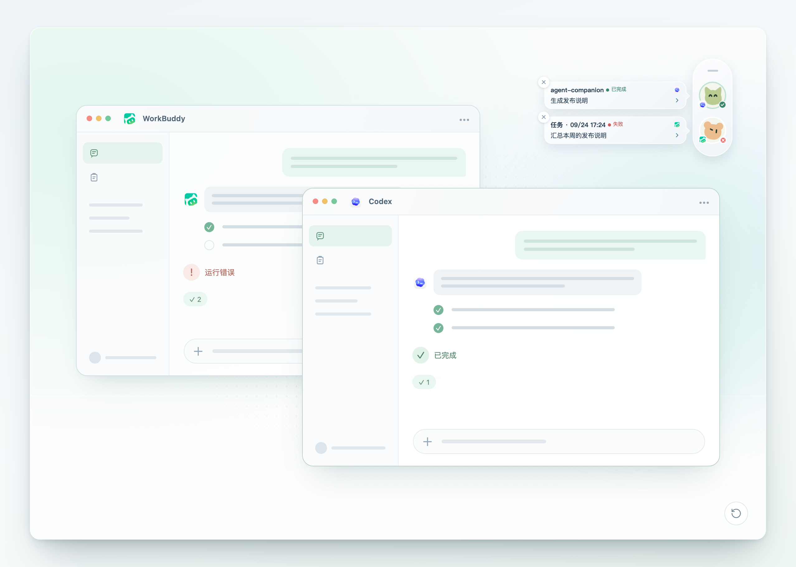

# workbuddy-switch

**English** | [한국어](./README.ko.md)

A desktop app (Tauri) for switching accounts across WorkBuddy, CodeBuddy IDE, CodeBuddy CLI and the VS Code CodeBuddy extension. All four support both the Domestic and International editions, and the app adds credit-expiry and token-usage monitoring.

<p align="center">
  
</p>

Multiple accounts share one login state, and the WorkBuddy login account switches with a single click. **Session copy** duplicates the current account's sessions under new ids for a target account — the source account's data is untouched and the copies belong to the target account in the cloud. **Linked sessions** automatically link copied sessions across accounts, so you can review every account's copy in one place and push new content to the others.

**Live demo**: [Open the GitHub Pages demo](https://changexbc.github.io/workbuddy-switch/) (read-only; accounts, credits and request records are fictional, all business actions are disabled, and it includes a read-only demo of the session rail)

## Quick Start

Download the installer for your platform from [GitHub Releases](https://github.com/changexbc/workbuddy-switch/releases/latest):

| Platform | Installer | Installation |
| --- | --- | --- |
| macOS Apple Silicon (M-series, arm64) | `workbuddy-switch_<version>_aarch64.dmg` | Open the DMG and drag `workbuddy-switch.app` into Applications |
| macOS Intel (x86_64) | `workbuddy-switch_<version>_x86_64.dmg` | Open the DMG and drag `workbuddy-switch.app` into Applications |
| Windows x64 | `workbuddy-switch_<version>_x64-setup.exe` | Run the installer and follow the prompts |
| Linux x64 | `workbuddy-switch_<version>_amd64.deb` / `workbuddy-switch_<version>_amd64.AppImage` | Install the `.deb` on Debian/Ubuntu; on other distributions make the AppImage executable and run it directly |

If macOS cannot verify the developer on first launch, Control-click the app in Finder and choose "Open", or go to System Settings → Privacy & Security and choose "Open Anyway". Only if the installer came from the official Releases above and macOS still reports the app "is damaged", run:

```bash
xattr -rd com.apple.quarantine "/Applications/workbuddy-switch.app"
```

If the app launches but switching accounts reports a permission error, see [macOS Permissions](#macos-permissions) below.

An npm / webui version also runs in the browser — see [npm / webui version](#npm--webui-version) at the end.

## Features

| Module | Description |
| --- | --- |
| Account management | OAuth QR-code sign-in, import/export accounts, delete accounts |
| Account switching | One-click switch of the WorkBuddy login account, with live progress |
| Session copy | Copy the sessions selected on the current account to a target account; the source account is untouched |
| Linked sessions | Copied sessions are linked across accounts automatically; review each account's copy of the same session per client, with incremental sync, divergence handling, and link add/remove |
| Credit expiry | Automatically queries each account's remaining credits and expiry date; anything expiring within 7 days is highlighted, sorted by urgency and marked "use first" |
| Credit statistics | Aggregates official request usage: overview, 30-day trend, model breakdown, per-account consumption and request details |
| Token statistics | Token overview and trends by source, including composition share, activity heatmap, project/model Top 10 and session ranking |
| CodeBuddy CLI | Shares the same account library as WorkBuddy with an independent default account; changes take effect immediately, no CLI restart required |
| CodeBuddy IDE | Switch the CodeBuddy IDE desktop client account, with optional session copy in the dialog; independent of CodeBuddy CLI |
| VS Code CodeBuddy extension | Switch the CodeBuddy extension account inside VS Code; VS Code can be closed automatically and reopened after the write |
| JetBrains IDE plugin | Switch the CodeBuddy plugin account in IntelliJ IDEA / PyCharm, writing to every IDE with the plugin installed in a single pass; IDEs can be closed and reopened automatically |
| Extension session copy | When switching extension accounts, optionally copy the current extension account's sessions to the target (additive; the source stays unchanged) |
| Auto rotation | In the background, sets the account with the most urgent credits as the next CodeBuddy CLI launch account; skipped while a CLI session is running |
| Auto update | Checks GitHub Releases for new versions; full-package updates are signature-verified |
| Session rail | Built-in Agent Companion rail on desktop, showing running / awaiting-confirmation / completed status for Codex / WorkBuddy / CodeBuddy / Codeg sessions; hover for details, click to jump back to the original session, hide it from the tray |
| Permission check | macOS authorization guide (App Management / Full Disk Access drag-to-authorize, plus automatic detection) |

## Supported Tools

| Tool | Account switching | Session copy | Auto close & reopen | Auto rotation | Rail monitoring |
| --- | :---: | :---: | :---: | :---: | :---: |
| WorkBuddy | ✅ | ✅ | ✅ | — | ✅ |
| CodeBuddy IDE | ✅ | ✅ | ✅ | — | ✅ |
| CodeBuddy CLI | ✅ | — | — | ✅ | — |
| VS Code CodeBuddy extension | ✅ | ✅ | ✅ | — | ✅ |
| JetBrains IDE plugin (IDEA / PyCharm) | ✅ | — | ✅ | — | — |

✅ supported, — not supported. Settings → "Supported tools" enables or disables each client's entry point; a disabled client hides its entry and stops status polling, without affecting the account library or other clients. JetBrains is off by default and can be enabled at any time in settings.

Switching CodeBuddy CLI closes the running CLI first, so the current session is interrupted and does not reopen automatically; the other clients can switch while running.

### Session rail (Agent Companion)

The desktop app bundles the [Agent Companion](https://github.com/changexbc/agent-companion) rail, which gathers every AI agent's task status onto the desktop so you can see at a glance who is still running and who needs your confirmation. Clicking a jumping session returns you to the original conversation. The rail can be dragged into position and shown or hidden from the tray at any time.

| Source | Jump to a specific session | Behavior on click |
| --- | :---: | --- |
| Codex (Desktop / CLI) | ✅ | Opens the given task in Codex Desktop |
| WorkBuddy (Domestic / International) | ✅ | Opens the given conversation in the matching edition |
| CodeBuddy IDE (Domestic / International) | — | Opens the project when a project path is known, otherwise just brings CodeBuddy forward |
| CodeBuddy VS Code extension | — | Tries to open the VS Code project the session belongs to; just brings VS Code forward when it cannot be determined |
| Codeg | ✅ | Opens the given chat session in Codeg |

Every source shows running / awaiting-confirmation / completed status; CodeBuddy CLI and the JetBrains plugin are not monitored. To enable it, use the rail icon in the bottom-left corner or Settings → Agent Companion; on first use, complete the setup in "Rail settings" (it relies on the client's Hooks / Webhook), where you also adjust the sources and appearance.

The rail in the web demo: one completed Codex session and one failed WorkBuddy session, each showing its own info card (captured from the [live demo](https://changexbc.github.io/agent-companion/); data is fictional).



More details and the standalone version: [Agent Companion repository](https://github.com/changexbc/agent-companion) · [Live demo](https://changexbc.github.io/agent-companion/)

## Usage

1. **Add and export accounts**: Accounts page → "OAuth QR sign-in", "Import backup"; "Export" backs up the selected accounts as JSON
2. **Switch accounts and edit account info**: Account card → "Switch", with an option to copy the current session; "Account info" lets you add a note and choose whether the card shows the account name, phone number or note
3. **Check credits and statistics**: The accounts page queries credit expiry automatically; click "Refresh credits" to update manually. Open "Credit statistics" and "Token statistics" from the sidebar for usage details
4. **Switch accounts for each client**: CodeBuddy CLI, CodeBuddy IDE and the VS Code CodeBuddy extension can all be switched from the account card; CodeBuddy IDE and the VS Code extension support copying the current account's sessions in the dialog. CodeBuddy IDE must be opened and signed in manually once before first use
5. **Manage linked sessions**: Sidebar → "Linked sessions" shows each account's copy of the same session per client; sync new content incrementally to the target account and resolve divergences. "New linked session" copies a session to a new account and links it
6. **Toggle client entry points**: Settings → "Supported tools" enables or disables each client; a disabled client is hidden on the accounts page and no longer polled, without affecting the account library. JetBrains is off by default
7. **Auto rotation**: Settings → CodeBuddy CLI auto rotation; when enabled, the default account is set automatically by credit urgency
8. **Updates**: The app checks public GitHub Releases automatically; upgrade from the bottom-left corner when a new version is found, or open the release page from settings to download manually

## Screenshots

### Managing WorkBuddy and CodeBuddy accounts

Account cards show login state, credit balance and expiring resources together; soon-to-expire credits are labelled on the card itself and cards are ordered by urgency.


### Linked sessions

Sessions copied to other accounts are linked automatically: per client (WorkBuddy / CodeBuddy IDE / CodeBuddy extension), the page shows every account's copy of the same session, and new content from the source account can be synced incrementally to the target. When the copies diverge, pick the one to keep, or copy a session to a new account and link it.


Open any link group to see the "session link graph": each account's copy of the same session appears as a branch, and on divergence the common ancestor and each branch's own updates are marked so you can pick the copy to keep and unify the rest.


### Credit statistics

The credit statistics page shows official request usage, daily trends, model distribution, per-account consumption and request details, with the data source and update time clearly displayed.


### Token statistics

The token statistics page shows token overview and trends by source, composition share, activity heatmap, project/model Top 10 and session ranking.


## macOS Permissions

Switching accounts writes WorkBuddy's authentication files, which macOS gates behind "App Management" (or "Full Disk Access"):

1. When the first switch reports "no permission", click "Open System Settings"
2. Prefer enabling workbuddy-switch under **App Management**; if it is not listed there, drag workbuddy-switch into the arrowed box under **Full Disk Access**
3. Restart the app after granting; Settings → "Permission check" verifies at any time

## npm / webui version

```bash
npm i -g workbuddy-switch
workbuddy-switch              # start the local server and open the browser
workbuddy-switch status       # show the current account in the terminal
```

The UI matches the desktop app and covers every module above, but it does not provide the session rail (desktop only). In webui mode, macOS permissions follow the terminal process that started the server; if that terminal already has Full Disk Access, nothing else is needed.

## Acknowledgements

Thanks to the [Linux.do](https://linux.do) community.

## License

[MIT](./LICENSE)
